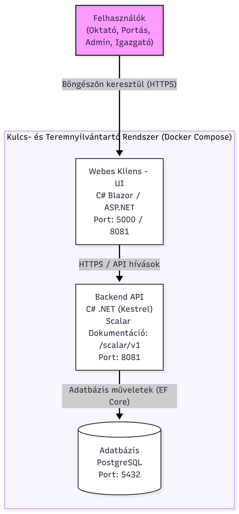
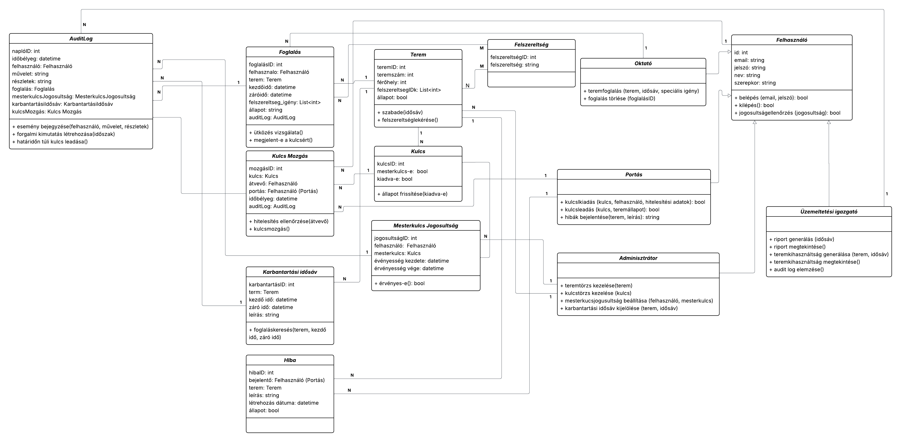

# ProjektLabor_1-es_csapat_2026-27-1
Ez a Pannon egyetem 2026/27/1-es félév Projekt labor (VEMIINB336PL) 1-es csapatának  Egyetemi Kulcs- és Teremnyilvántartó Rendszer feladata.

---

## Indítási Útmutató (Parancssorból)
A rendszer elindításához a gépeden telepítve kell legyen a **Docker** és a **Docker Desktop**.
1. **Előfeltételek ellenőrzése:** Nyiss meg egy terminált a projekt gyökérmappájában (ahol a docker-compose.yaml van), és győződj meg róla, hogy a Docker fut:
- `docker --version`
- `docker compose version`

2. **A rendszer buildelése és indítása:** Futtasd az alábbi parancsot a konténerek háttérben történő elindításához:
- `docker compose up --build -d`
Ez automatikusan felépíti a frontendet és a backendet a saját Dockerfile-jaik alapján, elindítja a PostgreSQL adatbázist, és létrehozza a szükséges köteteket.

3. **A rendszer leállítása:** Ha befejezted a munkát, az alábbi paranccsal tudod leállítani a konténereket:
- `docker compose down`

4. **Adatbázis migrációk és adatok:** A rendszer az első induláskor tesztadatokkal automatikusan feltölti az adatbázist.

---

## Hálózati Portok és Szolgáltatások
A projekt a Docker Compose környezetben az alábbi portokon érhető el:
- Frontend (projectlab1): Külső portok: 5000 / 8080 / 8081 (Belső port: 8080). Elérhető a https://localhost:8081 címen.
- Backend (webapi): Külső portok: 8080 / 8081 (Belső port: 8080). Az API és a Scalar API Dokumentáció a https://localhost:8081/scalar/v1 címen érhető el.
- Adatbázis (db): Külső és belső port: 5432. Helyi adatbázis-kezelőkből (pl. pgAdmin) a localhost:5432 címen érhető el.

---

## Rendszerséma és Architektúra
A rendszer egy többrétegű, konténerizált (Docker) webes alkalmazás, amely különválasztja a felhasználói felületet, az üzleti logikai backendet és az adatbázis-kezelést.
- A Blazor Frontend (ProjektLab1) felelős a felhasználói felületért és a nézetekért.
- A WebApi Backend (.NET Core / EF Core) biztosítja a REST API végpontokat és az üzleti logikát. A fejlesztői/dokumentációs felület a modern Scalar csomag segítségével érhető el (/scalar/v1 alatti útvonalon).
- A PostgreSQL Adatbázis tárolja strukturáltan az adatokat.

---

## Rendszerterv:

  

---

## Osztálydiagram:

---

## Tesztelési Fiókok (Seed Adatok)
A rendszer az első induláskor automatikusan feltölti az adatbázisbeli tesztfelhasználókat a `DbInitializer` script segítségével, hogy a szoftver azonnal kipróbálható legyen.

### Elérhető tesztfiókok:

| Szerepkör | Felhasználónév / E-mail cím | Jelszó |
| :--- | :--- | :--- |
| **Adminisztrátor** | `admin@uni.hu` | `titkos123` |
| **Üzemeltetési Igazgató** | `uzemeltetes@uni.hu` | `titkos123` |
| **Portás** | `portas@uni.hu` | `titkos123` |
| **Oktató** | `kiss.o@uni.hu` | `titkos123` |

> **Megjegyzés:** Ezek kizárólag fejlesztői környezetre szóló seed adatok, nem éles jelszavak. A tesztfelhasználók jelszava nincs hardcode-olva (fixen beleégetve) az üzleti logikai forráskódba, hanem a környezeti változóból (pl. `SEED_PASSWORD`) vagy az alapértelmezett biztonságos értékből töltődik be.
